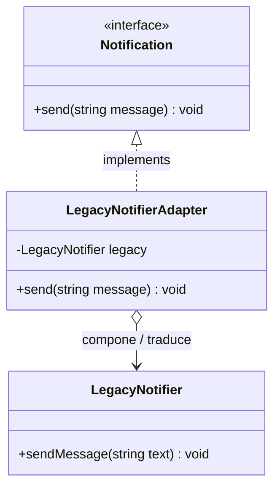

# Pull Request: Refactorización de Sistema Heredado mediante Patrón Adapter

- **Rama:** `feat/patron-adapter`
- **Archivo refactorizado:** `src/Legacy/LegacyNotifier.php`
- **Patrón aplicado:** Adapter (Estructural)
- **Autor:** Maxi Gonzalez (Grupo 3)
- **Revisor asignado:** Gabriel Pineda (Grupo 3)
- **Materia:** Metodología de Sistemas II — UTN FRRe

---

## 1. Deuda Técnica Encontrada

En `src/Legacy/LegacyNotifier.php` se identificaron graves transgresiones a los límites arquitectónicos del sistema:

1. **Líneas 38 a 41 — Modificación directa de código de terceros:**
   - **Síntoma:** Se introdujo el método `send(string $message)` directamente dentro de la clase `LegacyNotifier`, la cual pertenece a una librería o componente provisto por un tercero (utilizado también por Recepción y Facturación).
   - **Riesgo crítico:** En la siguiente actualización o parche del proveedor, cualquier método artesanal introducido en su código fuente se sobreescribe y desaparece, rompiendo el sistema en producción silenciosamente.
2. **Líneas 49 a 55 — Duplicación por copia y pega (`CopiaDeLegacyEnNuestroSistema`):**
   - **Síntoma:** Se duplicó el comportamiento de `sendMessage()` en una clase local para "no depender del proveedor".
   - **Violación DRY:** Dos implementaciones idénticas que obligan a mantenimiento manual duplicado.

---

## 2. Patrón Aplicado y Justificación frente a Alternativas

Se implementó el patrón **Adapter (Estructural)** mediante composición de objetos:

- Se preservó la clase `LegacyNotifier` intacta, respetando su condición de componente de terceros cerrado a modificaciones.
- Se eliminaron por completo el método intrusivo `send()` y la clase duplicada `CopiaDeLegacyEnNuestroSistema`.
- Se introdujo la clase `LegacyNotifierAdapter` implementando el contrato `Notification`:
  ```php
  final class LegacyNotifierAdapter implements Notification
  {
      public function __construct(private LegacyNotifier $legacy) {}

      public function send(string $message): void
      {
          $this->legacy->sendMessage($message);
      }
  }
  ```

### Justificación frente a alternativas descartadas:

- **Frente a Adapter de Clases (Herencia / `extends LegacyNotifier`):** PHP no cuenta con herencia múltiple y extender la clase externa acopla de por vida el adaptador a la implementación concreta de terceros. El Adapter de Objetos (por composición) es la solución estándar recomendada por el GoF porque favorece la composición sobre la herencia y permite adaptar dinámicamente cualquier subclase del proveedor.
- **Frente a la duplicación:** Mantener copias locales desincroniza al laboratorio ante correcciones de seguridad, formatos o protocolos de red introducidos por el proveedor.

---

## 3. Diagrama de Clases (UML Mermaid)



---

## 4. Resolución del Ejercicio 3 (TP) y Pregunta de Cierre

La consigna del TP establece:
> *"Borrar el método send() de LegacyNotifier y la clase CopiaDeLegacyEnNuestroSistema, y hacer que todo pase por el Adapter.*
> *Pregunta para el PR: Si mañana el proveedor cambia sendMessage() por dispatch(), ¿cuántos archivos de tu sistema cambian?"*

**Respuesta a la pregunta de la cátedra:**
Cambia **exactamente UN (1) solo archivo**: `src/Legacy/LegacyNotifier.php`, en la línea interna del adaptador:
```php
$this->legacy->dispatch($message);
```
Todo el resto de la aplicación (servicios, controladores, vistas) permanece **100% inalterado**, ya que solo dependen de la abstracción `Notification::send()`. La incompatibilidad queda completamente encapsulada y aislada del núcleo del laboratorio.

---

## 5. Análisis de Consecuencias Negativas / Trade-offs

- **Indirección adicional:** Cada aviso que deba cursarse por el sistema heredado realiza un salto de llamada adicional en la pila de ejecución (`adapter->send() -> legacy->sendMessage()`), con un costo de instanciación mínimo.
- **Mapeo de firmas complejas:** Si en el futuro la API del proveedor comienza a exigir credenciales o metadatos contextuales que nuestro contrato `Notification` no contempla, el adaptador requerirá configuraciones por constructor o valores por defecto.
- **Justificación en este dominio:** El desacoplamiento obtenido y la garantía de no invasión del código del proveedor compensan con creces el costo insignificante de la indirección.

---

## 6. Verificación y Regresión

- Sintaxis validada con `php -l`.
- Prueba del adaptador:
  ```php
  $adapter = new LegacyNotifierAdapter(new LegacyNotifier());
  $adapter->send("Aviso legado de prueba");
  // Salida: [LEGACY] Aviso legado de prueba
  ```
- Rutas `crear`, `listar` y `reporte` de `public/index.php` verificadas sin excepciones.
