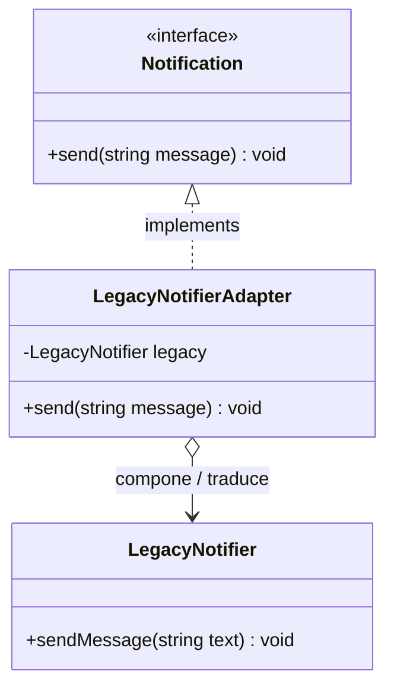

# Pull Request: Refactorización de Sistema Heredado mediante Patrón Adapter

- **Rama:** `feat/patron-adapter`
- **Archivo refactorizado:** `src/Legacy/LegacyNotifier.php`
- **Patrón aplicado:** Adapter (Estructural)
- **Materia:** Metodología de Sistemas II — UTN FRRe

---

## 1. Deuda Técnica Encontrada

En `src/Legacy/LegacyNotifier.php` se identificaron graves transgresiones a los límites arquitectónicos y principios de diseño:

1. **Líneas 38 a 41 — Modificación de código de terceros:**
   - **Síntoma:** Se añadió el método `send(string $message)` directamente dentro de la clase `LegacyNotifier`, la cual pertenece a un proveedor externo compartido por otras áreas (Recepción y Facturación).
   - **Riesgo crítico:** En una actualización o reemplazo de la librería externa provista por el proveedor, cualquier método agregado artesanalmente desaparece, produciendo un `Fatal Error: Call to undefined method` en tiempo de ejecución.
2. **Líneas 49 a 55 — Duplicación por copia y pega (`CopiaDeLegacyEnNuestroSistema`):**
   - **Síntoma:** Se duplicó el comportamiento de `sendMessage()` en una clase local para "evitar depender del proveedor".
   - **Violación DRY:** Dos implementaciones idénticas que deben sincronizarse manualmente ante cualquier cambio de comportamiento.

---

## 2. Patrón Aplicado y Justificación frente a Alternativas

Se implementó el patrón **Adapter (Estructural)** mediante composición de objetos:

- Se preservó la clase `LegacyNotifier` intacta, respetando su condición de biblioteca externa no editable.
- Se eliminaron por completo el método intrusivo `send()` y la clase redundante `CopiaDeLegacyEnNuestroSistema`.
- Se introdujo `LegacyNotifierAdapter` implementando el contrato `Notification`:
  ```php
  final class LegacyNotifierAdapter implements Notification
  {
      public function __construct(private LegacyNotifier $legacy) {}

      public function send(string $message): void
      {
          $this->legacy->sendMessage($message);
      }
  }
  ```

### Justificación frente a alternativas descartadas:

- **Frente a Adapter de Clases (Herencia múltiple / `extends LegacyNotifier`):** PHP no soporta herencia múltiple y extender de una clase externa acopla fuertemente el ciclo de vida del adaptador al proveedor. El Adapter de Objetos (composición) es el estándar recomendado por el GoF porque permite adaptar subclases y no invade la jerarquía.
- **Frente a continuar con la clase copiada:** Mantener código duplicado genera desincronización inevitable en producción cuando el proveedor corrija bugs de red o agregue logs en `sendMessage()`.

---

## 3. Diagrama de Clases (UML Mermaid)



---

## 4. Resolución del Ejercicio 3 (TP) y Pregunta de Cierre

La consigna del TP establece:
> *"Borrar el método send() de LegacyNotifier y la clase CopiaDeLegacyEnNuestroSistema, y hacer que todo pase por el Adapter.*
> *Pregunta para el PR: Si mañana el proveedor cambia sendMessage() por dispatch(), ¿cuántos archivos de tu sistema cambian?"*

**Respuesta a la pregunta de la cátedra:**
Cambia **exactamente UN (1) solo archivo**: `src/Legacy/LegacyNotifier.php`, en la línea interna del adaptador:
```php
$this->legacy->dispatch($message);
```
Todo el resto de la aplicación (controladores, servicios de órdenes, despachadores de eventos) permanece **100% inalterado**, ya que solo dependen de la abstracción `Notification::send()`. La incompatibilidad queda encapsulada y aislada del núcleo de dominio.

---

## 5. Análisis de Consecuencias Negativas / Trade-offs

- **Indirección adicional:** Cada notificación que deba pasar por el sistema heredado realiza un salto de llamada adicional en la pila de ejecución (`adapter->send() -> legacy->sendMessage()`), con un costo de memoria mínimo por la instancia envoltorio.
- **Sobrecarga si la interfaz adaptada diverge mucho:** Si el sistema heredado requiriera parámetros que nuestro contrato `Notification` no provee (ej. credenciales de sesión por mensaje o códigos de severidad), el adaptador requeriría estado interno adicional o valores por defecto.
- **Justificación en este dominio:** El desacoplamiento obtenido y la protección contra actualizaciones de terceros superan ampliamente el costo insignificante de la indirección en PHP.

---

## 6. Verificación y Regresión

- Sintaxis validada con `php -l`.
- Prueba del adaptador:
  ```php
  $adapter = new LegacyNotifierAdapter(new LegacyNotifier());
  $adapter->send("Prueba de aviso legado");
  // Salida: [LEGACY] Prueba de aviso legado
  ```
- Compatibilidad general del flujo verificada sin excepciones.
