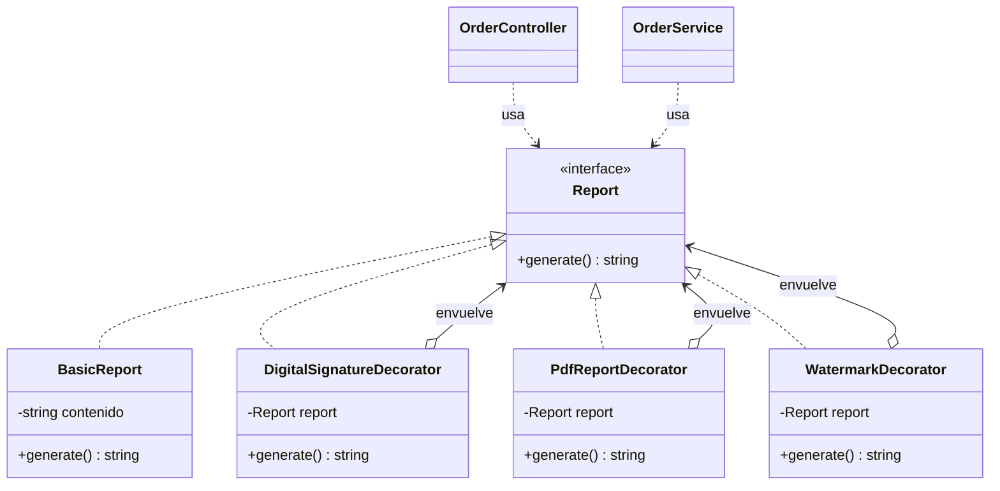

# Pull Request: Refactorización de Reportes mediante Patrón Decorator

- **Rama:** `feat/patron-decorator`
- **Archivo refactorizado:** `src/Reports/ReportGenerator.php` (pasa a `src/Reports/Report.php`)
- **Patrón aplicado:** Decorator (Estructural)
- **Autora:** Valeria Budino (Grupo 3)
- **Materia:** Metodología de Sistemas II — UTN FRRe

> **Nota:** el PR #4 (Decorator) figura como mergeado en GitHub, pero se revirtió
> con el force push sobre `main` del 09/11. Este PR lo reemplaza.

**El problema en una frase:** cada agregado nuevo a un reporte obliga a sumar un
parámetro booleano y un `if` al mismo método, y en la llamada
`generate(true, true, false)` no se entiende qué se activó.

---

## 1. Deuda Técnica Encontrada

Líneas del código original (commit `318322f` de `main`):

1. **`src/Reports/ReportGenerator.php`, líneas 28 a 33: firma con tres booleanos (*boolean trap*).**
   ```php
   public function generate(string $contenido, bool $conFirmaDigital = false,
                            bool $conPdf = false, bool $conMarcaDeAgua = false): string
   ```
   Agregar un agregado nuevo (por ejemplo un código QR) obliga a **modificar** la firma
   del método y a todos los que lo llaman. Viola **OCP**.
2. **`src/Reports/ReportGenerator.php`, líneas 36 a 46: un `if` por agregado.** Con 3 banderas hay
   8 combinaciones posibles dentro de un mismo método; con 5 serían 32.
3. **`src/Controllers/OrderController.php`, línea 89:** `generate('Pedidos del dia', true, true, true)`.
4. **`src/Services/OrderService.php`, línea 85:** `generate("Pedido {$id}", true, true, false)`.

   En los puntos 3 y 4 no se puede saber qué agregados lleva el reporte sin abrir `ReportGenerator`.

---

## 2. Patrón Aplicado y Justificación

Se aplicó **Decorator**:

- `Report`: interfaz con `generate(): string`. La cumplen el reporte base **y** los decoradores.
- `BasicReport`: genera `"Reporte: {contenido}"`, sin agregados.
- `DigitalSignatureDecorator`, `PdfReportDecorator`, `WatermarkDecorator`: cada uno recibe
  un `Report`, lo envuelve y le agrega su parte.

Ahora la llamada se lee sola:

```php
$reporte = new WatermarkDecorator(
    new PdfReportDecorator(
        new DigitalSignatureDecorator(new BasicReport('Pedidos del dia'))
    )
);
echo $reporte->generate();
```

Agregar un código QR es **crear una clase nueva** `QrCodeDecorator`, sin tocar ninguna de las existentes.

### Alternativas descartadas

- **Herencia (una subclase por combinación):** `ReporteConFirmaYPdf`, `ReporteConPdfYMarca`...
  Con 3 agregados son 8 clases; con 4, 16. Es la explosión de subclases que Decorator
  evita usando composición.
- **Objeto de opciones / array de configuración** (`generate($contenido, ['pdf' => true])`):
  soluciona la legibilidad de la llamada, pero los `if` siguen adentro del mismo método y cada
  agregado nuevo sigue obligando a modificarlo. No resuelve OCP.
- **Builder:** sirve cuando un objeto tiene muchos pasos de construcción. Acá el problema no es
  construir el reporte sino **sumarle comportamiento** combinable en tiempo de ejecución.
- **Clase abstracta `ReportDecorator`** (la versión clásica del GoF): se descartó porque con tres
  decoradores lo único que tendrían en común es un constructor de una línea. Agregar una clase
  para eso es sobreingeniería; si aparecen más decoradores con lógica compartida, se agrega.

### Decisión de estructura

Todas las clases quedaron en un único archivo `src/Reports/Report.php`, siguiendo la convención
que usó el equipo en Strategy (`PriceCalculator.php`) y que permite `phpcs.xml` (excluye
`MultipleClasses`). Así `public/index.php` cambia en una sola línea.

---

## 3. Diagrama UML de Clases (Mermaid)



---

## 4. Consecuencias Negativas / Trade-offs

- **El orden de los decoradores cambia el resultado.** Firmar y después pasar a PDF no da lo mismo
  que al revés, y el código no impide armarlo mal. **Cómo lo compensamos:** el orden acordado está
  documentado en el encabezado de `Report.php`, y el test `testDecoratorOrderChangesTheResult`
  deja escrito que el orden importa.
- **Más clases:** de 1 clase pasamos a 1 interfaz + 4 clases. Para entender qué tiene un reporte
  hay que seguir la cadena de objetos.
- **La construcción es más larga:** `new A(new B(new C(...)))` ocupa más que `generate(true, true, true)`,
  aunque se entiende sin abrir otro archivo.
- **No se validan las combinaciones:** nada impide aplicar `PdfReportDecorator` dos veces y obtener
  `"+ PDF + PDF"`. Antes la bandera, por ser booleana, lo impedía.
- **Depuración:** un error dentro de un decorador aparece en el stack trace como varias llamadas
  `generate()` anidadas.
- **Lo que este PR no resuelve:** la cantidad de copias del descuento `0.7` no cambia. Esa métrica
  la mejoran Strategy, Repository y MVC.

---

## 5. Verificación (comportamiento conservado)

1. **Tests de caracterización primero** (commit `e7add9b`): se fijaron las salidas del
   `ReportGenerator` original **antes** de tocarlo. En el commit del refactor los tests se adaptan
   a las clases nuevas manteniendo **exactamente los mismos textos esperados**:
   - `Reporte: Pedidos del dia + firma digital + PDF + marca de agua`
   - `Reporte: Pedido 1 + firma digital + PDF`
2. **Salida de la app antes vs. después**, comparada byte a byte con `cmp`: **idéntica** en
   `?accion=crear`, `?accion=listar`, `?accion=reporte` y en `OrderService::procesarPedidoCompleto()`.
3. `composer check` (phpcs + phpstan + phpunit): **OK, 19 tests**. Se agregó `src/Reports` a
   `phpcs.xml` y `phpstan.neon` para que el CI también revise este código.
4. Se eliminó `ReportGenerator.php` completo: no queda código viejo "por las dudas".
