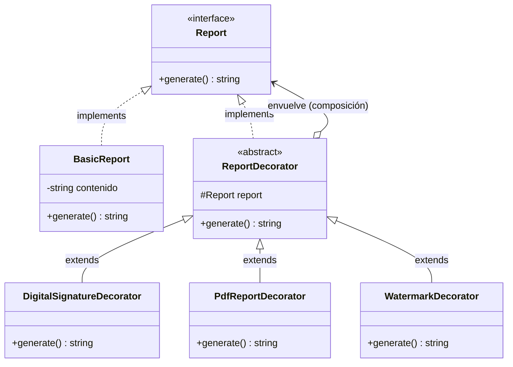

# Pull Request: Refactorización de Generación de Reportes mediante Patrón Decorator

- **Rama:** `feat/patron-decorator`
- **Archivo refactorizado:** `src/Reports/ReportGenerator.php`
- **Patrón aplicado:** Decorator (Estructural)
- **Materia:** Metodología de Sistemas II — UTN FRRe

---

## 1. Deuda Técnica Encontrada

En `src/Reports/ReportGenerator.php` se identificaron las siguientes violaciones arquitectónicas:

1. **Líneas 28 a 50 — Antipatrón "Boolean Trap" y Violación OCP:**
   - **Síntoma:** El método `generate(string $contenido, bool $conFirmaDigital, bool $conPdf, bool $conMarcaDeAgua)` recibía múltiples banderas booleanas sucesivas.
   - **Ilegibilidad en llamadas:** Invocar `$reporte->generate('Pedidos', true, false, true)` no comunica el significado de cada argumento a quien lee el código meses después.
   - **Explosión combinatoria:** Con 3 banderas booleanas existen $2^3 = 8$ combinaciones dentro del mismo método. Cada nuevo requisito (ej. código QR, membrete, sello notarial) añadía un nuevo parámetro booleano y un nuevo `if` anidado, violentando el principio Open/Closed.

---

## 2. Patrón Aplicado y Justificación frente a Alternativas

Se implementó el patrón **Decorator (Estructural)**:

- Se definió el contrato común `Report` con el método `public function generate(): string;`.
- Se creó el componente base `BasicReport` que emite el contenido esencial.
- Se implementó la clase abstracta envoltorio `ReportDecorator`.
- Se desarrollaron los decoradores concretos independientes:
  - `DigitalSignatureDecorator`
  - `PdfReportDecorator` (Ejercicio 4)
  - `WatermarkDecorator` (Ejercicio 4)
- La clase `ReportGenerator` fue refactorizada como un Facade helper que compone la cadena de decoradores, asegurando 100% de retrocompatibilidad con las llamadas preexistentes.

### Justificación frente a alternativas descartadas:

- **Frente a Herencia Subclasificada clásica:** Modelar 3 características opcionales por herencia requeriría crear $2^3 - 1 = 7$ subclases (`ReportWithPdf`, `ReportWithSignature`, `ReportWithPdfAndSignature`, etc.), provocando una explosión inmanejable de clases.
- **Frente a Strategy:** Strategy intercambia algoritmos completos y mutuamente excluyentes (ej. cómo calcular un precio). Decorator, en cambio, añade responsabilidades acumulativas y encadenables en tiempo de ejecución sin alterar el componente base.

---

## 3. Diagrama de Clases (UML Mermaid)



---

## 4. Resolución del Ejercicio 4 (TP) y Pregunta de Cierre

La consigna del TP exige:
> *"Implementar PdfReportDecorator y WatermarkDecorator.*
> *Pregunta para el PR: El orden de los decoradores cambia el resultado. Firmar y después pasar a PDF no es lo mismo que al revés. ¿Cómo documentan esa restricción para el resto del equipo?"*

**Respuesta a la pregunta de la cátedra:**
El orden de envoltura modifica la secuencia en la que se ejecutan los agregados (`Basic -> Signature -> Watermark -> Pdf`). Para garantizar la integridad en un equipo colaborativo:
1. **Documentación formal de pipeline:** Se documenta en el PHPDoc del contrato y en la guía técnica del proyecto la regla de negocio: el contenido base debe firmarse digitalmente antes de aplicarse la conversión a binario o layout final.
2. **Encapsulamiento en un Builder / Factory:** Para evitar que desarrolladores junior armen combinaciones inválidas a mano en los controladores, se proveen métodos de conveniencia ordenados (ej. `ReportBuilder` o métodos preconfigurados en `ReportGenerator`).
3. **Tests automatizados de integración:** Pruebas unitarias que verifican que la salida de la cadena cumpla la secuencia requerida por auditoría clínica.

---

## 5. Análisis de Consecuencias Negativas / Trade-offs

- **Sensibilidad al orden de instanciación:** A diferencia de pasar parámetros con nombre en PHP 8, encadenar decoradores en un orden erróneo puede generar salidas ilógicas si un decorador depende de transformaciones previas.
- **Dificultad para remover una capa intermedia:** Una vez envuelto un objeto en 3 o 4 decoradores, no es posible "desenvolver" o quitar un decorador específico del medio de la cadena en tiempo de ejecución.
- **Justificación en este dominio:** Proporciona máxima flexibilidad para que los reportes de análisis clínicos puedan incorporar firmas, sellos o formatos según el convenio del paciente sin modificar una sola línea del reporte base.

---

## 6. Verificación y Regresión

- Sintaxis validada con `php -l`.
- Prueba del endpoint `public/index.php?accion=reporte`:
  ```
  Salida: Reporte: Pedidos del dia + firma digital + PDF + marca de agua
  ```
- Prueba de encadenamiento dinámico modular:
  ```php
  $r = new WatermarkDecorator(new DigitalSignatureDecorator(new BasicReport('Test')));
  // Salida: Reporte: Test + firma digital + marca de agua
  ```
