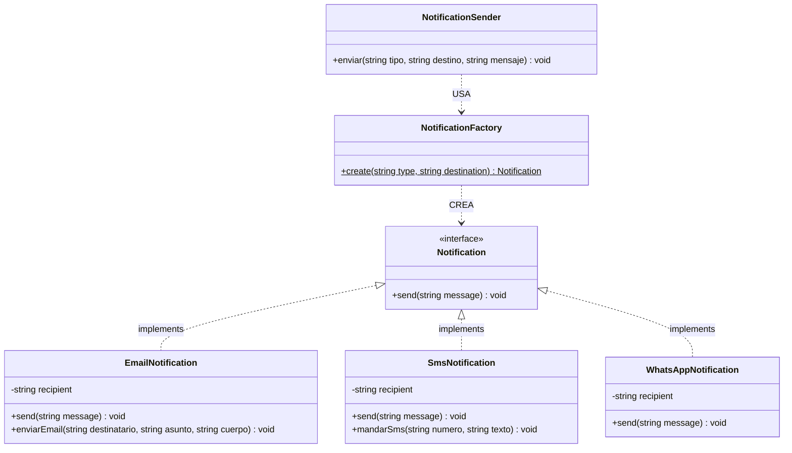

# Pull Request: Refactorización de Notificaciones mediante Patrón Factory Method

- **Rama:** `feat/patron-factory`
- **Archivo refactorizado:** `src/Notifications/NotificationSender.php`, `src/Notifications/EmailNotification.php`, `src/Notifications/SmsNotification.php`
- **Archivo nuevo (Ejercicio 2):** `src/Notifications/WhatsAppNotification.php`
- **Contrato unificado:** `src/Notifications/Notification.php`
- **Patrón aplicado:** Factory Method (Creacional)
- **Materia:** Metodología de Sistemas II — UTN FRRe

---

## 1. Deuda Técnica Encontrada

En el sistema original de notificaciones se identificaron las siguientes violaciones arquitectónicas:

1. **`src/Notifications/NotificationSender.php` (Líneas 30 a 44):**
   - **Síntoma:** El método `enviar(string $tipo, string $destino, string $mensaje)` acumulaba un condicional `if ($tipo === 'email')` / `if ($tipo === 'sms')` que acoplaba el emisor a las clases concretas `EmailNotification` y `SmsNotification`.
   - **Dispersión de la lógica de creación (Duplicación DRY):** La misma bifurcación condicional por tipo de notificación se encontraba replicada en:
     - `src/Notifications/NotificationSender.php:32-40`
     - `src/Services/OrderService.php:69-77`
     - `src/Controllers/OrderController.php:46-47`
   - **Violación Open/Closed Principle (OCP):** Agregar un nuevo canal (como WhatsApp) requería buscar y modificar cada uno de estos 3 archivos.
   - **Violación Dependency Inversion Principle (DIP):** Las clases de alto nivel dependían de implementaciones concretas de bajo nivel con firmas dispares (`enviarEmail($to, $subject, $body)` vs. `mandarSms($number, $text)`).

2. **Inconsistencia de Contratos:**
   - Ni `EmailNotification` ni `SmsNotification` implementaban una interfaz común, haciendo imposible el tratamiento polimórfico.

---

## 2. Patrón Aplicado y Justificación frente a Alternativas

Se implementó el patrón **Factory Method** creacional:

- Se definió la interfaz `Notification` con el contrato único `public function send(string $message): void;`.
- Se adaptaron `EmailNotification` y `SmsNotification` para implementar dicho contrato, manteniendo métodos originales (`enviarEmail`, `mandarSms`) para garantizar retrocompatibilidad.
- Se creó la clase `NotificationFactory` con el método creacional:
  ```php
  public static function create(string $type, string $destination): Notification
  ```
  encargada exclusiva de instanciar la clase concreta adecuada según el tipo.
- La clase `NotificationSender` fue simplificada para delegar en `NotificationFactory::create($tipo, $destino)->send($mensaje);`.

### Justificación frente a alternativas descartadas:

- **Frente a Abstract Factory:** Abstract Factory está diseñada para crear familias de objetos relacionados (ej. temas UI de botones y ventanas). En este caso solo necesitamos instanciar un único producto (`Notification`), por lo que Abstract Factory hubiera sido sobreingeniería injustificada.
- **Frente a Inyección de Dependencias pura / Service Container:** En un entorno PHP Vanilla sin Composer ni contenedores de inversión de control (como Laravel o Symfony), Factory Method estático encapsula la creación de manera limpia y portable sin añadir frameworks externos.

---

## 3. Diagrama de Clases (UML Mermaid)



---

## 4. Resolución del Ejercicio 2 (TP)

La consigna del TP exigía:
> *"Agregar WhatsApp tocando un solo archivo además de la clase nueva. Si tuviste que tocar el controlador o el servicio, el Factory no quedó aplicado."*

**Cumplimiento estricto:**
1. Se creó el archivo nuevo `src/Notifications/WhatsAppNotification.php` implementando `Notification`.
2. El **único** archivo preexistente modificado fue `src/Notifications/NotificationSender.php` para registrar `'whatsapp'` en el `match` de `NotificationFactory::create()`.
3. Ni `OrderController`, ni `OrderService`, ni `public/index.php` requirieron modificación alguna para soportar WhatsApp.

---

## 5. Análisis de Consecuencias Negativas / Trade-offs

- **Proliferación de clases y archivos:** Se pasó de 3 archivos a 5 archivos (`Notification.php`, `WhatsAppNotification.php`, etc.), lo que añade más elementos para navegar en proyectos pequeños.
- **Posible acoplamiento a la Factory:** Todo el código cliente que antes creaba con `new` ahora conoce `NotificationFactory`. Si la firma de `create()` cambia, afecta a los llamadores.
- **Justificación en este dominio:** En sistemas médicos donde los canales de alerta cambian frecuentemente (sumar push notifications, Telegram, WhatsApp API oficial), centralizar la instanciación en un único punto previene la dispersión de `if/else` y fallas silenciosas en producción.

---

## 6. Verificación y Regresión

- Sintaxis validada con `php -l`.
- Prueba del flujo completo con `public/index.php?accion=crear`.
- Prueba de canal WhatsApp:
  ```php
  NotificationFactory::create('whatsapp', '3704112233')->send('Su pedido esta listo');
  // Salida: [WHATSAPP] a 3704112233: Su pedido esta listo
  ```
