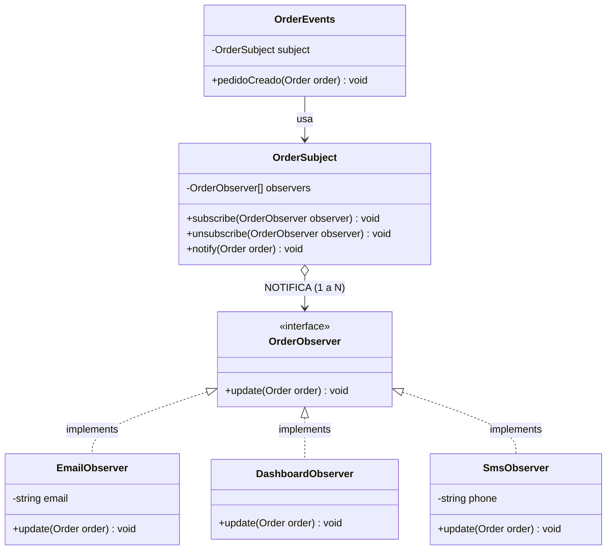

# Pull Request: Refactorización de Eventos de Pedidos mediante Patrón Observer

- **Rama:** `feat/patron-observer`
- **Archivo refactorizado:** `src/Events/OrderEvents.php`
- **Patrón aplicado:** Observer (Comportamiento)
- **Materia:** Metodología de Sistemas II — UTN FRRe

---

## 1. Deuda Técnica Encontrada

En `src/Events/OrderEvents.php` se identificaron las siguientes violaciones arquitectónicas:

1. **Líneas 28 a 41 — Acoplamiento Rígido y Cascada Secuencial:**
   - **Síntoma:** El método `pedidoCreado(Order $order)` instanciaba manualmente con `new` a cada clase interesada (`EmailNotification`, `SmsNotification`) y realizaba llamadas hardcodeadas.
   - **Violación Dependency Inversion Principle (DIP):** Una clase orquestadora de alto nivel dependía de detalles de bajo nivel.
   - **Violación Open/Closed Principle (OCP):** Incorporar un nuevo interesado (ej. auditoría médica, webhook de facturación o panel en tiempo real) exigía abrir y modificar el método.
   - **Peligro de estado inconsistente:** Si una línea intermedia lanzaba una excepción (ej. fallo de red en SMS), el email ya se había despachado pero el dashboard nunca se enteraba, cortando silenciosamente la secuencia.

---

## 2. Patrón Aplicado y Justificación frente a Alternativas

Se implementó el patrón **Observer (Comportamiento)**:

- Se definió la interfaz `OrderObserver` con el contrato `public function update(Order $order): void;`.
- Se creó el sujeto `OrderSubject` que mantiene una colección desacoplada de objetos `OrderObserver` mediante métodos `subscribe()`, `unsubscribe()` y `notify()`.
- Se implementaron observadores independientes:
  - `EmailObserver`
  - `DashboardObserver`
  - `SmsObserver` (incorporado como resolución del Ejercicio 5).
- La clase `OrderEvents` se mantiene como fachada de compatibilidad para el código cliente preexistente, inicializando el sujeto con sus subscriptores por defecto.

### Justificación frente a alternativas descartadas:

- **Frente a Polling / Chequeo periódico:** El polling consume recursos innecesarios consultando la base de datos a intervalos fijos; Observer provee notificación reactiva inmediata (*push* en vez de *pull*).
- **Frente a Mediator / Event Bus global complejo:** En una aplicación PHP Vanilla sin framework, un Mediator centralizado con múltiples canales añade complejidad excesiva. Observer provee la relación 1-a-N precisa requerida entre el pedido y sus interesados.

---

## 3. Diagrama de Clases (UML Mermaid)



---

## 4. Resolución del Ejercicio 5 (TP) y Pregunta de Cierre

La consigna del TP establece:
> *"Agregar SmsObserver sin tocar el sujeto (OrderSubject).*
> *Pregunta para el PR: Con Observer, leyendo el código del pedido ya NO se ve quién se entera del evento. Ganamos desacoplamiento y perdimos trazabilidad. ¿Cómo lo compensan?"*

**Respuesta a la pregunta de la cátedra:**
1. **Resolución técnica:** Se definió la clase `SmsObserver` implementando `OrderObserver`. Para que comience a recibir eventos, únicamente se registra en el sujeto mediante `$subject->subscribe(new SmsObserver())`, demostrando que `OrderSubject` permaneció 100% cerrado a modificaciones.
2. **Compensación de la pérdida de trazabilidad:**
   - **Registro de auditoría estructurado (Logging):** Dentro de `OrderSubject::notify()`, se registra qué observadores fueron notificados y su tiempo de respuesta.
   - **Convención y visibilidad de eventos:** Nomenclatura explícita en las clases de observadores (`*Observer`) ubicadas en un único directorio (`src/Events/`).
   - **Pruebas automatizadas de suscripción:** Suites de test que verifican que la lista de listeners suscritos al evento de creación contenga todos los servicios críticos del dominio.

---

## 5. Análisis de Consecuencias Negativas / Trade-offs

- **Pérdida de trazabilidad directa del flujo:** Un desarrollador que inspecciona la creación de un pedido ya no puede presionar "Ir a la definición" en el IDE para ver todas las acciones que se disparan en cascada.
- **Orden de ejecución indeterminado:** Los observadores no deben asumir que se ejecutarán en una secuencia específica; deben ser completamente independientes entre sí.
- **Fugas de memoria potenciales:** En aplicaciones de larga vida (daemons o Swoole/RoadRunner), no desuscribir observadores (`unsubscribe`) puede acumular referencias a objetos muertos.

---

## 6. Verificación y Regresión

- Sintaxis validada con `php -l`.
- Prueba del flujo completo con `public/index.php?accion=crear`.
- Prueba modular del sujeto y observadores:
  ```php
  $subject = new OrderSubject();
  $subject->subscribe(new SmsObserver('3704000000'));
  $subject->subscribe(new DashboardObserver());
  $subject->notify(new Order(10, 'Test', 1000, 'particular'));
  // Salida: [SMS] y [DASHBOARD] correctamente despachados
  ```
