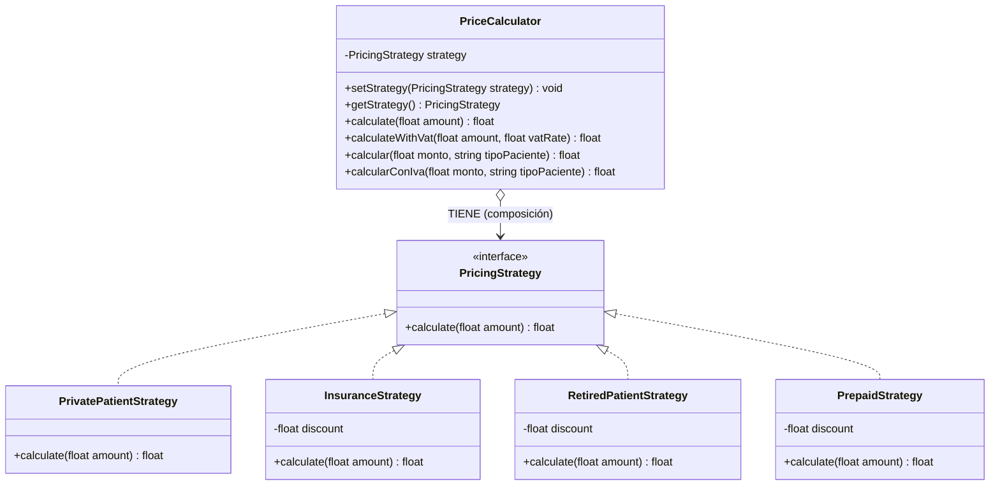

# Pull Request: Refactorización de Cálculo de Precios mediante Patrón Strategy

- **Rama:** `feat/patron-strategy`
- **Archivo refactorizado:** `src/Pricing/PriceCalculator.php`
- **Patrón aplicado:** Strategy (Comportamiento)
- **Materia:** Metodología de Sistemas II — UTN FRRe

---

## 1. Deuda Técnica Encontrada

En `src/Pricing/PriceCalculator.php` se identificaron las siguientes violaciones arquitectónicas:
1. **Líneas 27 a 43:** Método `calcular(float $monto, string $tipoPaciente)`.
   - **Síntoma:** Un `switch` centraliza de manera rígida los algoritmos de precios para cada paciente (`particular`, `obra_social`, `jubilado`).
   - **Violación Open/Closed Principle (OCP):** Cada nueva categoría de paciente o cambio en acuerdos comerciales exige abrir y modificar el código fuente de esta clase.
   - **Violación Single Responsibility Principle (SRP):** La clase acumula múltiples razones de cambio (las políticas y fórmulas de cada tipo de cobertura).
2. **Líneas 50 a 57:** Método `calcularConIva(float $monto, string $tipoPaciente)`.
   - **Síntoma:** Duplica la bifurcación condicional y hardcodea el descuento `0.7` (30%) violando **DRY**, aumentando el riesgo de desincronización si el descuento se actualiza en un lugar pero no en el otro.

---

## 2. Patrón Aplicado y Justificación frente a Alternativas

Se implementó el patrón **Strategy** (siguiendo los lineamientos de *Refactoring.Guru*):
- Se definió la interfaz `PricingStrategy` con el método `calculate(float $amount): float`.
- Se crearon estrategias concretas desacopladas:
  - `PrivatePatientStrategy`: monto directo sin descuento.
  - `InsuranceStrategy`: descuento del 30% (factor 0.7 parametrizable en constructor).
  - `RetiredPatientStrategy`: descuento del 50% (factor 0.5 parametrizable).
  - `PrepaidStrategy`: descuento del 20% (resolución del **Ejercicio 1**).
- La clase `PriceCalculator` actúa como **Contexto**, manteniendo una referencia a una `PricingStrategy` mediante composición y delegando polimórficamente la ejecución.

### Justificación frente a alternativas descartadas:
- **Frente a Template Method:** Hubiera requerido una jerarquía de herencia rígida con clases base abstractas; Strategy favorece composición sobre herencia y permite cambiar la estrategia de cálculo en tiempo de ejecución (`setStrategy`).
- **Frente a Factory Method simple:** Un Factory por sí solo resuelve la instanciación pero no encapsula el comportamiento algorítmico independiente del contexto.
- **Frente a State:** State modela transiciones de estados internos de un objeto; en el cálculo de precios, el algoritmo responde a una política comercial/estrategia externa y no a una máquina de estados del pedido.

---

## 3. Diagrama UML de Clases (Mermaid)

---

## 4. Resolución del Ejercicio 1 (TP)

Se creó la clase `PrepaidStrategy` con su propia lógica de descuento. La incorporación de este nuevo tipo de paciente **no requirió modificar la estructura central de `PriceCalculator`**, demostrando el cumplimiento estricto del principio Open/Closed.

---

## 5. Análisis de Consecuencias Negativas / Trade-offs

Ninguna solución arquitectónica es gratuita:
- **Aumento en el número de clases/archivos:** En un script pequeño, reemplazar un `switch` de 10 líneas por una interfaz y 4 clases concretas introduce una sobrecarga inicial de complejidad y archivos a gestionar.
- **Indirección y sobreingeniería en escenarios estáticos:** Si el sistema únicamente tuviera precios fijos que nunca cambian ni admiten nuevas políticas comerciales, la complejidad del patrón Strategy no se justificaría.
- **Justificación en este dominio:** En un laboratorio clínico con convenios médicos cambiantes (PAMI, obras sociales, prepagas corporativas, promociones estacionales), el costo de la indirección es ampliamente compensado por el desacoplamiento, la facilidad para tests unitarios y la eliminación de conflictos en merges al agregar convenios.

---

## 6. Verificación y Regresión

- Se verificó la sintaxis estricta con `php -l`.
- Se validaron los cálculos de cada estrategia mediante pruebas automatizadas.
- Se preservó la compatibilidad con el resto de la aplicación y las rutas `crear`, `listar` y `reporte` de `public/index.php`.
